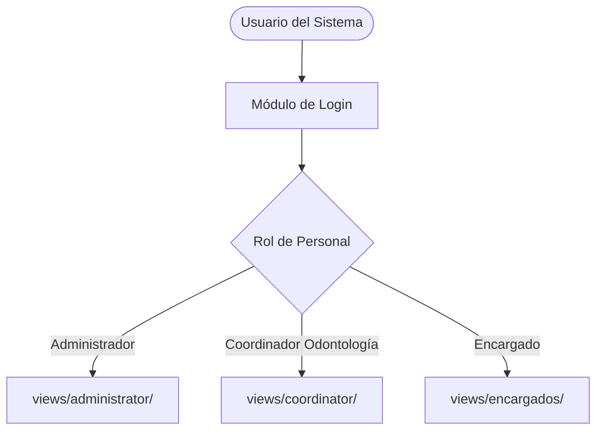

# 🏛️ Sistema de Gestión de Inventario - ULAT (Carrera de Odontología)

Este es un sistema web robusto y seguro para la gestión del inventario físico (equipos, mobiliario, materiales y accesorios) de la **Carrera de Odontología** de la **Universidad Latinoamericana de Tecnología (ULAT)**. El sistema permite administrar de forma integral desde la infraestructura de ubicaciones (sedes, edificios, pisos y ambientes) hasta las actividades del día a día, tales como el préstamo de artículos, el registro de mantenimientos, el uso de laboratorios/clínicas por estudiantes y docentes, reportes estadísticos y descarte de equipos.

Desarrollado en **Laravel 9** y **MySQL**, cuenta con un control de accesos estricto y una interfaz de usuario organizada y fluida basada en **Bootstrap 5.3**, **SweetAlert2** y **FontAwesome**.

---

## 🚀 Características Principales

1. **Gestión de Infraestructura Multisede**:
   - Jerarquía completa de ubicaciones: `Sedes` ➔ `Edificios` ➔ `Pisos` ➔ `Ambientes` (Aulas, Clínicas, Laboratorios).
2. **Control Detallado de Activos**:
   - Clasificación por: **Equipos** (unidades dentales, autoclaves, etc.), **Mobiliario**, **Materiales** y **Accesorios** (repuestos independientes o acoplados a equipos).
   - Carga de imágenes/fotos para un reconocimiento visual rápido de cada activo.
3. **Registro de Operaciones Diarias**:
   - **Préstamos**: Gestión del flujo de salida y devolución de activos, registrando solicitante, observaciones e historial de devoluciones.
   - **Uso de Ambientes (Movimientos)**: Control detallado del ingreso y salida de usuarios (estudiantes/docentes) a laboratorios o clínicas, documentando fecha, hora, propósito y semestre.
4. **Ciclo de Vida y Mantenimiento**:
   - **Mantenimientos**: Registro de solicitudes con diagnóstico inicial, asignación de técnicos externos/internos, seguimiento del estado de reparación y reporte de finalización.
   - **Descartes (Bajas)**: Bitácora de retiro definitivo de activos dañados u obsoletos para mantener el inventario limpio y actualizado.
5. **Generador de Reportes Impresos**:
   - Filtros avanzados para la generación de reportes listos para imprimir (PDF a través de estilos de impresión web) sobre estado de equipos, compras, descartes, personal activo/inactivo, y reemplazos de accesorios.

---

## 👥 Arquitectura de Vistas por Roles

El sistema implementa una separación estricta de responsabilidades en la capa de presentación (`resources/views/`), organizada por directorios de vistas independientes que corresponden a cada tipo de personal:



### 1. Administrador ([views/administrator/](file:///c:/Users/Jhon/Desktop/proyectos/backup%20proyecto%20inventario/oficial%20para%20desplegar/inventarioULAT/resources/views/administrator/))
* **Layout Principal**: [admin.blade.php](file:///c:/Users/Jhon/Desktop/proyectos/backup%20proyecto%20inventario/oficial%20para%20desplegar/inventarioULAT/resources/views/layouts/admin.blade.php)
* **Alcance**: Gestión global de la plataforma.
* **Vistas Clave**:
  - `sedes.blade.php`, `pisos.blade.php`, `ambiente.blade.php`: Configuración estructural del campus (sedes, edificios, pisos y ambientes).
  - `personal.blade.php`, `personalInhabilitado.blade.php`, `usuario.blade.php`: Administración del personal, gestión de accesos (usuarios y contraseñas cifradas) e inhabilitaciones.
  - `reportes.blade.php`: Suite central para generar reportes dinámicos de compras, inventarios, mantenimientos y descartes.
  - `movimientosAdmin.blade.php`, `prestamosAdmin.blade.php`, `mantenimiento.blade.php`: Supervisión global de todas las bitácoras del sistema.

### 2. Coordinador Odontología ([views/coordinator/](file:///c:/Users/Jhon/Desktop/proyectos/backup%20proyecto%20inventario/oficial%20para%20desplegar/inventarioULAT/resources/views/coordinator/))
* **Layout Principal**: [coodinacion.blade.php](file:///c:/Users/Jhon/Desktop/proyectos/backup%20proyecto%20inventario/oficial%20para%20desplegar/inventarioULAT/resources/views/layouts/coodinacion.blade.php) y [pagClinica.blade.php](file:///c:/Users/Jhon/Desktop/proyectos/backup%20proyecto%20inventario/oficial%20para%20desplegar/inventarioULAT/resources/views/layouts/pagClinica.blade.php)
* **Alcance**: Monitoreo técnico, académico e investigativo de laboratorios y de la clínica odontológica.
* **Vistas Clave**:
  - `laboratorios.blade.php`, `ambiente.blade.php`: Búsqueda y visualización de recursos asignados a las clínicas dentales.
  - `accesorios.blade.php`: Supervisión de las piezas y repuestos.
  - `reportes/`: Vistas especializadas en generar reportes internos de la clínica de odontología (equipos descartados, reposición de piezas, etc.).
  - `historialMantenimiento.blade.php`, `movimientos.blade.php`, `prestamos.blade.php`: Consultas directas sobre el estado logístico de su división.

### 3. Encargado ([views/encargados/](file:///c:/Users/Jhon/Desktop/proyectos/backup%20proyecto%20inventario/oficial%20para%20desplegar/inventarioULAT/resources/views/encargados/))
* **Layout Principal**: [encargado.blade.php](file:///c:/Users/Jhon/Desktop/proyectos/backup%20proyecto%20inventario/oficial%20para%20desplegar/inventarioULAT/resources/views/layouts/encargado.blade.php)
* **Alcance**: Operaciones transaccionales del día a día del inventario.
* **Vistas Clave**:
  - `registroEquipo.blade.php`, `regitroMobiliario.blade.php`, `registrarMaterial.blade.php`, `registroAccesorio.blade.php`: Formularios con carga de imágenes para el alta de nuevos activos.
  - `movimientoAmbiente.blade.php`: Gestión de check-in / check-out de los laboratorios por los estudiantes/docentes.
  - `prestamoPag.blade.php`: Despacho y recepción física de préstamos de artículos.
  - `mantenimientoPage.blade.php`, `modal_nuevo_mantenimiento.blade.php`, `modal_finalizar_mantenimiento.blade.php`: Registro directo de incidentes y cierre de órdenes de reparación.
  - `registrarUsuarios.blade.php`: Altas y bajas de los estudiantes y docentes solicitantes.

---

## 🗄️ Modelo de Datos (Estructura de MySQL)

El modelo de base de datos se refleja directamente en los modelos Eloquent de Laravel ([app/Models/](file:///c:/Users/Jhon/Desktop/proyectos/backup%20proyecto%20inventario/oficial%20para%20desplegar/inventarioULAT/app/Models/)), estructurando las relaciones de la siguiente forma:

### Estructura Jerárquica de Ubicaciones
* **Sede (`Sede`)**: Posee muchos Edificios (`Edificio`).
* **Edificio (`Edificio`)**: Pertenece a una Sede. Posee muchos Pisos (`Piso`) y Personal (`Personal`).
* **Piso (`Piso`)**: Pertenece a un Edificio. Posee muchos Ambientes (`Ambiente`).
* **Ambiente (`Ambiente`)**: Pertenece a un Piso y posee un Tipo (`TipoAmbiente`). Alberga colecciones de `Equipo`, `Mobiliario` y `Material`.

### Gestión de Activos Físicos
* **Equipo (`Equipo`)**: Vinculado a un `Ambiente` y a una `Foto`. Tiene componentes (`Componente`) y accesorios asociados a través de una relación de muchos a muchos (`equipo_has_accesorio`).
* **Mobiliario (`Mobiliario`)**: Vinculado a un `Ambiente`, un `TipoMobiliario` y una `Foto`.
* **Material (`Material`)**: Consumibles de un `Ambiente` vinculados a una `Foto`.
* **Accesorio (`Accesorio`)**: Repuestos vinculados a una `Foto` e historial de reemplazos (`HistorialAccesorio`). Puede pertenecer a uno o más Equipos.
* **Foto (`Foto`)**: Almacena las rutas de los archivos de imágenes de los activos.

### Control de Flujos Operativos
* **Uso de Ambientes (`UsoAmbiente` y `FinalUso`)**: Registra la entrada del usuario (`Usuario`) y el personal que inicia el uso. Al cerrar el turno, se crea un `FinalUso` registrando hora, fecha y personal de salida.
* **Préstamos (`Prestamo`, `DetallePrestamo` y `Devolucion`)**: Un registro principal de préstamo a nombre de un solicitante. Contiene varios registros de `DetallePrestamo` (que asocia de forma dinámica un `cod_articulo` a Equipos, Mobiliarios o Materiales). La finalización se marca mediante una `Devolucion`.
* **Mantenimiento (`Mantenimiento` / `inicio_mantenimiento`, `DetallesMantenimiento` y `FinalMantenimiento`)**: El inicio de mantenimiento asigna un técnico (`Tecnico`) y registra el reporte inicial. Afecta a un artículo específico (`DetallesMantenimiento`). Al solucionarse, se asocia un `FinalMantenimiento` con el informe definitivo.
* **Descarte (`Descarte`)**: Registra la fecha, motivo y personal que da de baja un activo.

---

## 🔒 Seguridad y Autenticación

El sistema implementa características de seguridad avanzadas:
1. **Autenticación Basada en el Modelo de Personal**:
   - En lugar de usar la tabla predeterminada de usuarios de Laravel, el framework autentica sobre el modelo `Personal` (que implementa `AuthenticatableContract`), enlazándose de 1 a 1 con la tabla `login`.
2. **Middleware de Control de Roles**:
   - Mediante el middleware personalizado [CheckRole.php](file:///c:/Users/Jhon/Desktop/proyectos/backup%20proyecto%20inventario/oficial%20para%20desplegar/inventarioULAT/app/Http/Middleware/CheckRole.php) (`role:<Rol>`), se verifica dinámicamente si el rol del usuario (`tipoPersonal->descripcion_per`) coincide con el requerido por la ruta (`Administrador`, `Coordinador Odontologia` o `Encargado`).
3. **Protección Contra Ataques de Fuerza Bruta**:
   - [AuthController.php](file:///c:/Users/Jhon/Desktop/proyectos/backup%20proyecto%20inventario/oficial%20para%20desplegar/inventarioULAT/app/Http/Controllers/AuthController.php) incluye limitación de tasa de intentos de inicio de sesión (`RateLimiter`). Si se fallan 3 intentos consecutivos, la combinación de usuario e IP queda bloqueada temporalmente por seguridad.
4. **Regeneración de Sesión**:
   - Al iniciar sesión con éxito, se regenera la sesión para mitigar vulnerabilidades de *Session Fixation*.

---

## 🛠️ Instalación y Configuración Local

Sigue estos pasos para instalar y ejecutar el proyecto localmente:

### Requisitos Previos
* **PHP**: `>= 8.0`
* **Composer**: Gestor de dependencias de PHP.
* **MySQL**: Servidor de base de datos.
* **Servidor Local**: Apache/MySQL (ej. XAMPP, Laragon, o PHP Server integrado).

### Pasos de Configuración

1. **Clonar el Repositorio / Acceder al Directorio**:
   ```bash
   cd inventarioULAT
   ```

2. **Instalar Dependencias de Composer**:
   ```bash
   composer install
   ```

3. **Configurar el Archivo de Entorno**:
   Copia el archivo `.env.example` y renómbralo a `.env`:
   ```bash
   cp .env.example .env
   ```
   Abre el archivo `.env` y configura los datos de tu base de datos local MySQL:
   ```env
   DB_CONNECTION=mysql
   DB_HOST=127.0.0.1
   DB_PORT=3306
   DB_DATABASE=nombre_de_tu_base_de_datos
   DB_USERNAME=usuario_mysql (ej. root)
   DB_PASSWORD=contrasena_mysql (ej. vacía o tu contraseña)
   ```

4. **Generar la Clave de Aplicación de Laravel**:
   ```bash
   php artisan key:generate
   ```

5. **Configurar la Base de Datos**:
   * Si cuentas con un volcado SQL, impórtalo directamente en tu base de datos MySQL.
   * Alternativamente, si deseas crear las tablas base del framework, puedes ejecutar:
     ```bash
     php artisan migrate
     ```

6. **Iniciar el Servidor de Desarrollo**:
   ```bash
   php artisan serve
   ```
   La aplicación estará disponible en [http://localhost:8000](http://localhost:8000).

---

## 📂 Directorios Clave del Proyecto

* 📄 **Rutas**: [web.php](file:///c:/Users/Jhon/Desktop/proyectos/backup%20proyecto%20inventario/oficial%20para%20desplegar/inventarioULAT/routes/web.php) — Contiene todas las rutas protegidas por prefijos y middlewares de roles.
* 📁 **Modelos**: [app/Models/](file:///c:/Users/Jhon/Desktop/proyectos/backup%20proyecto%20inventario/oficial%20para%20desplegar/inventarioULAT/app/Models/) — Modelos de Eloquent que representan las tablas y sus relaciones.
* 📁 **Controladores**: [app/Http/Controllers/](file:///c:/Users/Jhon/Desktop/proyectos/backup%20proyecto%20inventario/oficial%20para%20desplegar/inventarioULAT/app/Http/Controllers/) — Toda la lógica de negocio dividida en las subcarpetas `Administrador/`, `Coordinator/`, `Encargado/` y `Reportes/`.
* 📁 **Vistas**: [resources/views/](file:///c:/Users/Jhon/Desktop/proyectos/backup%20proyecto%20inventario/oficial%20para%20desplegar/inventarioULAT/resources/views/) — Contiene las plantillas de Blade divididas por roles para mantener la independencia visual y de flujo.
* 📁 **Archivos Estáticos**: `public/css/` y `public/js/` — Hojas de estilos y archivos de scripts específicos para el diseño visual de cada panel.
